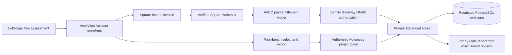

# LotScope Advanced — purchase-to-report release blueprint

**Release condition:** A paid customer must move from LotScope discovery to a genuine Square-hosted purchase, a Square-confirmed AVCC entitlement, a Gateway-authenticated private project, a saved selected Workbench revision, a fresh reload, and a matching Pondy Flats customer report. Production deployment is blocked until each connected step has recorded evidence.

## Product and customer promise

| Product | One-time price | Access granted by verified payment | Renewal |
|---|---:|---|---|
| `lotscope-advanced-pilot` | $0.01 | Seven days | None |
| `lotscope-advanced-paid` | $9.99 | Ninety days | None |

Ninety days is a fixed duration, not literally three calendar months. Customers may buy again; new time is scheduled after the previous pass, and each payment has an independent refund authority. A product entitlement does **not** assign a private project, grant construction approval, or guarantee professional engineering or permit compliance.

## Verified implementation boundaries

1. **Square catalog:** The Account storefront displays each product, price, duration and checkout eligibility. The production variation tokens from the user-supplied Square export are `EQ6MKXBYEO5VQYFISQF2Z6MP` (Pilot) and `EXN3CZZ4GXYXMXJOXBEA5KDJ` (Paid). Confirm via Square Catalog API in the correct merchant/location before activation. Sandbox uses independently provisioned `LOTSCOPE_SQUARE_SANDBOX_PILOT_VARIATION_ID` and `LOTSCOPE_SQUARE_SANDBOX_PAID_VARIATION_ID`; no production-ID fallback.
2. **Commerce authority:** Account browser sends only product code to AVCC. AVCC loads its trusted price and variation mapping, builds a Square catalog-linked order, checks order variation and total, and publishes a hosted invoice. It creates a **pending** purchase; browser redirect does not grant anything.
3. **Payment authority:** A validated Square webhook with a freshly fetched `PAID` invoice and exact matching amount promotes pending → paid. AVCC writes a scoped, expiring entitlement. Pending, malformed, replayed, refunded or unrecognized events cannot grant Advanced. A refund revokes only the entitlement attached to that exact purchase.
4. **Identity:** A real AeroVista Account session is resolved through Identity Gateway. Every protected operation checks `lotscope.advanced.access` **and** `lotscope.project.read` or `lotscope.project.edit` scoped to the actual `lotscope_project` ID. This is checked live, not cached in the browser.
5. **Project provisioning:** Staff/audited authority creates the canonical source parcel and locks. A project must be assigned to the customer independently of payment. The broker's `lotscope_advanced_broker` PostgreSQL role can read immutable source and insert design revisions, but cannot alter canonical source facts.
6. **Workbench:** The customer compares designs, explicitly saves a selected room layout, and exports a `.lotscope.json` package with the candidate plus its `designDocument`.
7. **Advanced account workspace:** `/advanced/projects/{projectId}` accepts only a source-compatible package belonging to the authorized project. A signed private broker PUT saves the exact document. The browser GET read-back verifies the exact candidate and document (canonical JSON comparison tolerates PostgreSQL JSONB key order changes).
8. **Report:** The server generates the report only from the broker-stored saved candidate and document. The customer workspace checks the report's embedded design-document evidence against the reloaded revision before offering the download or preview. A mismatched report fails closed.

### Architecture



## Explicit release switches (default OFF)

| Setting | Role | Required before activation |
|---|---|---|
| `LOTSCOPE_ADVANCED_CHECKOUT_ENABLED=true` | Enables LotScope-specific checkout in a configured environment | Connected staging acceptance |
| `LOTSCOPE_ADVANCED_PRODUCTION_APPROVED=true` | Additional approval for real-money production checkout | Production customer journey accepted, rollback proven |
| `LOTSCOPE_SQUARE_SANDBOX_PILOT_VARIATION_ID` | Correct Square Sandbox variation for $0.01 | Sandbox Catalog API lookup |
| `LOTSCOPE_SQUARE_SANDBOX_PAID_VARIATION_ID` | Correct Square Sandbox variation for $9.99 | Sandbox Catalog API lookup |
| `IDGW_SERVICE_SECRET_LOTSCOPE_ADVANCED` | Dedicated signed relying-party credential | Protected secret provisioning and live Gateway registration |
| `IDGW_BROKER_SERVICE_ADDITIONS=...lotscope_advanced...` | Explicit Gateway allowlist | Isolated staging and then approved production cutover |
| `LOTSCOPE_ADVANCED_BROKER_HMAC_SECRET` | Distinct signed app → broker credential | Private transport and rotation plan |
| `LOTSCOPE_ADVANCED_PRIVATE_DATABASE_URL` | Restricted PostgreSQL service credentials | DB permission check and canonical project provisioning |
| `LOTSCOPE_ADVANCED_BROKER_ORIGIN` | Private HTTPS broker origin | TLS, reachability and no public ingress proof |

Do not commit credentials. Never enable production checkout just because Square is configured. A test payment does not automatically prove project access or report consistency.

## Connected acceptance checklist — all mandatory for launch

- [ ] **S0 Merchant mapping:** Retrieve both item *variations* from Square production and Sandbox and verify price, currency, status, location and correct product code. Record IDs and retrieval time without credentials.
- [ ] **S1 Hosted Sandbox purchase:** From an authenticated, disposable Account session, select Pilot and complete Square's hosted Sandbox payment page manually. Capture AVCC purchase ID, Square invoice ID and payment result. Confirm initial status pending and no entitlement before `PAID`.
- [ ] **S2 Entitlement ledger:** Confirm signed event, fresh Square invoice amount, single entitlement, seven-day expiry and correct customer identity. Repeat for 90-day Paid in Sandbox; verify idempotency, wrong price, refund and renewal paths.
- [ ] **S3 Private Identity:** Start an isolated Gateway connected to disposable AVCC storage. Prove real session resolve and both live capability checks. Wrong secret, expired/revoked session, unpaid customer and different project must be rejected.
- [ ] **S4 Private broker:** Start real restricted PostgreSQL broker behind a verified private HTTPS transport. Verify no unauthenticated public listener, no source table mutation permission and proper signed-request replay handling.
- [ ] **S5 Customer browser:** Login through the actual Account handoff. Open a staff-provisioned project, import the chosen Workbench export, click Save, reload the page and GET the exact saved revision. Capture screenshots and revision SHA.
- [ ] **S6 Pondy Flats report:** Generate HTML from persisted revision, match the embedded `data-report-design-document` to the reloaded source, inspect roof/site/room evidence and verify no stale alternative or mirrored parcel orientation.
- [ ] **S7 Cross-customer and refund:** Confirm a different account cannot read/edit/report the project; refund and expiration remove access on the next request; failed providers fail closed without deleting saved data.
- [ ] **S8 Release gate:** Run the NXCore local release suite on exact *merged* commit IDs and record logs; require all project/browser tests and manual payment receipts separately. Document hosted CI billing restriction; do not call a skipped check a pass.
- [ ] **S9 Promotion and rollback:** Review planned DNS/private ingress, production Square webhook subscription and store release flags. Promote in a controlled window. Immediately disable `LOTSCOPE_ADVANCED_CHECKOUT_ENABLED` on failure, preserve DB rows and invoice records, and roll back services if necessary.

## Repeatable local evidence commands

```sh
# From the appropriate verified checkout on NXCore:
npm run lint
npm run test:advanced-persistence
npm run test:advanced-sso
npm run test:advanced-broker-signature
npm run test:advanced-broker-core
npm run test:advanced-jsonb-reload
npm run test:advanced-account-ui
npm run build

# AVCC backend: full suite + the commerce and checkout-release gate.
cd backend && ./node_modules/.bin/vitest run --reporter=dot

# Real staging browser acceptance (requires a genuine authorized account and
# project, a saved Workbench package, and a PRIVATE Playwright storage-state
# file outside the repository):
SKIP_WEB_SERVER=1 PW_BROWSERS=chromium ADVANCED_ACCEPTANCE_REQUIRED=true \
ADVANCED_STAGE_URL=https://<staging-lotscope-origin> \
ADVANCED_STAGE_PROJECT_ID=<assigned-project> \
ADVANCED_STAGE_PACKAGE_PATH=/private/path/design.lotscope.json \
ADVANCED_STAGE_STORAGE_STATE=/private/path/account-storage-state.json \
node node_modules/@playwright/test/cli.js test tests/lotscope_advanced_live_journey.spec.js
```

The last command is intentionally not successful without real staging fixtures. Browser API mocks and isolated HMAC tests are useful engineering checks but are not evidence of live Square payment, a private Gateway deployment or customer acceptance.

## Status at implementation handoff

**Locally built / code-proven:** Square catalog linked orders and exact total checks, timed entitlements, refund separation, explicit release flags, Account store UX, Advanced account project import/save/read-back/report UI, JSONB-safe document validation, DOM mock acceptance, restricted PostgreSQL broker acceptance. **Not yet proven:** actual Square payment, registered production-equivalent Gateway with disposable AVCC session, private HTTPS broker transport, and authenticated deployed browser acceptance. Keep production on HOLD until all mandatory items pass.
